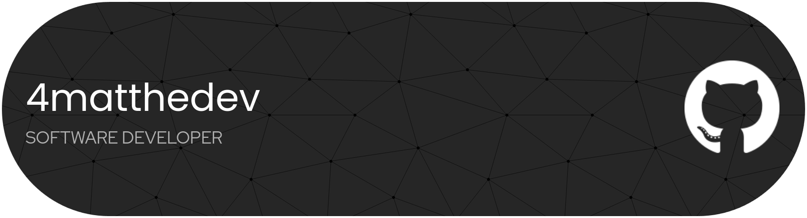
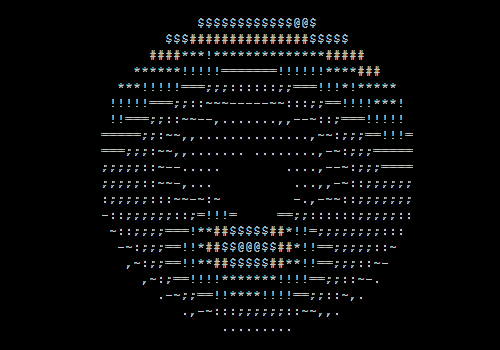

 <div align="center">

  ## `4matthedev`


### SOFTWARE DEVELOPER · SYSTEMS ENTHUSIAST · BUILDER

**Turning ideas into working software.**

  <div align="center">
  
  </div>

<br/>

[](https://github.com/4matthedev)
[](https://discord.com/users/1474804138352316598)
[](mailto:4matthedev@gmail.com)

</div>

---

## `01 / ABOUT`

I'm a software developer who enjoys understanding how things work beneath the surface and building software that solves real problems.

I enjoy experimenting with different technologies, exploring system architecture, and turning ideas into functional projects.

- Building independent software projects
- Exploring systems programming and software architecture
- Developing AI-powered applications and autonomous agents
- Creating developer tools and automation
- Using Linux and open-source technologies

---

## `02 / PROGRAMMING LANGUAGES`

<div align="center">


</div>

---

## `03 / TOOLS & TECHNOLOGIES`

<div align="center">


</div>

---

## `04 / CURRENT PROJECT`

<div align="center">

### `METIS AGENT`

**A local-first autonomous coding agent built with Go.**

[](https://github.com/4matthedev/metis-agent)

</div>

An ongoing project exploring local AI, autonomous coding workflows, and practical agent architecture.

---

## `05 / HARDWARE & ENVIRONMENT`

<div align="center">


</div>

---

## `06 / PHILOSOPHY`

```text
> Understand before building.
> Build before overthinking.
> Keep complexity under control.
> Learn by experimenting.
> Make things that are useful.
> Improve what already exists.
```

---

## `07 / FIND ME`

<div align="center">

[](https://github.com/4matthedev)
[](https://discord.com/users/1474804138352316598)
[](mailto:4matthedev@gmail.com)

</div>

---

<div align="center">

### `BUILD · BREAK · UNDERSTAND · IMPROVE`

<sub>Designed with simplicity. Built with curiosity.</sub>

<br/>



</div>
